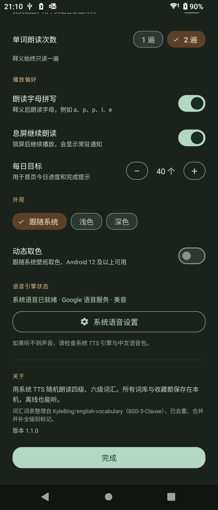
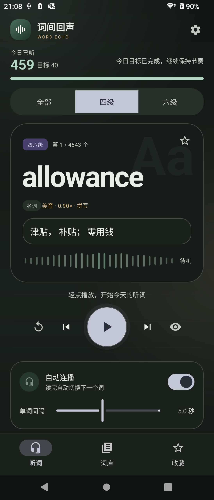

# 词间回声 · Word Echo

使用 Material 3 实现的 Android 英语听词应用。调用系统 TTS 朗读 CET-4 / CET-6 英文单词及中文释义，词库内置，应用未申请网络权限。

- 当前版本：1.1.1（versionCode 5）
- 最低系统：Android 8.0（API 26）
- 编译 / 目标 SDK：35
- 开发语言：Java 17
- 构建工具：Gradle 8.13 + AGP 8.13.2

## 功能

- **词库**：6,661 个去重词条，其中 CET-4 4,543 个、CET-6 3,991 个，两库共有 1,873 个。
- **随机听词**：每轮打乱顺序，全部播放后重新洗牌。
- **系统 TTS**：先读英文，再读中文释义；支持美音 / 英音和 0.60×–1.40× 语速。
- **朗读选项**：单词可读 1 或 2 遍，释义固定 1 遍；可选字母拼读，例如 `a, p, p, l, e`。
- **自动连播**：词间间隔可调，范围 1–10 秒。
- **息屏朗读**：可选开启；开启后通过前台服务和常驻通知在锁屏后继续播放。
- **收藏与搜索**：支持星标收藏、随机复习，以及按英文或中文释义搜索。
- **每日目标**：默认 30 个，可在 10–200 之间按 5 个步进调整。
- **外观**：跟随系统 / 浅色 / 深色；Android 12+ 可选动态取色，Android 12 以下使用默认主题色。
- **导航适配**：适配三键导航和手势导航的安全区。

## 截图

| 听词 | 词库 |
| --- | --- |
|  |  |

| 设置 | 动态取色 |
| --- | --- |
|  |  |

## 安装

从 [Releases](https://github.com/Xinjigalaxy/word-echo/releases/latest) 下载 APK：

```bash
adb install -r WordEcho-v1.1.1.apk
```

Release 中的 APK 使用 Android debug key 签名，仅用于安装测试。正式分发请使用自己的签名密钥。

## 构建

环境要求：

- JDK 17
- Android SDK Platform 35、Build-Tools 35.x
- Gradle 8.13（仓库自带 Wrapper）

```bash
export ANDROID_HOME=/path/to/Android/Sdk
./gradlew :app:assembleDebug
```

也可在 `local.properties` 中配置：

```properties
sdk.dir=/path/to/Android/Sdk
```

输出路径：`app/build/outputs/apk/debug/app-debug.apk`。

仓库不包含签名密钥。本地 debug 构建由 Gradle 使用默认调试签名；release 构建需自行配置签名。

## 词库格式

运行时读取 `app/src/main/assets/words.tsv`：

```text
级别掩码<TAB>单词<TAB>中文释义
```

级别掩码：`1` = CET-4，`2` = CET-6，`3` = 两者共有。

原始词表来自 [KyleBing/english-vocabulary](https://github.com/KyleBing/english-vocabulary)，按 BSD 3-Clause License 使用。本项目对词表做了去重、合并和级别标记；完整声明见 [THIRD_PARTY_NOTICES.md](THIRD_PARTY_NOTICES.md)。

## 项目结构

```text
app/src/main/
├── assets/words.tsv                  # 内置四六级词库
├── java/com/zs/wordecho/
│   ├── MainActivity.java             # 播放调度、导航、收藏与设置协调
│   ├── data/                         # 词条、词库、偏好、收藏
│   ├── speech/SpeechController.java  # 系统 TTS 封装
│   ├── playback/                     # 息屏播放前台服务
│   └── ui/                           # Material 3 页面、弹层、波形等
└── res/                              # 主题、布局、图标
```

## 已知限制

- 上游词表不提供音标和例句，应用未自行补充。
- 发音质量取决于系统 TTS 引擎和语音包；第三方引擎可能缺少中文语音。
- 息屏播放需要 Android 13+ 通知权限；通知被禁用时，前台服务仍可运行，但通知不可见。
- 动态取色仅在 Android 12 及以上可用。
- 数据仅保存在本机，不支持云同步或导出。

## 更新日志

- **1.1.1**：主页面主要视觉元素完整支持动态取色；关闭后恢复默认主题。
- **1.1.0**：修复三键导航安全区；新增息屏朗读、每日目标、单词 1/2 遍、字母拼读、动态取色。
- **1.0.2**：支持发现并跟随第三方系统 TTS 引擎，返回前台时检测默认引擎变化。
- **1.0.1**：修复旧语速值导致设置页 Slider 崩溃。
- **1.0.0**：首个版本。

## 许可

本仓库代码未附加独立的 `LICENSE` 文件，默认保留所有权利。第三方词表使用 BSD 3-Clause License，详见 [THIRD_PARTY_NOTICES.md](THIRD_PARTY_NOTICES.md)。

## 仓库

https://github.com/Xinjigalaxy/word-echo
