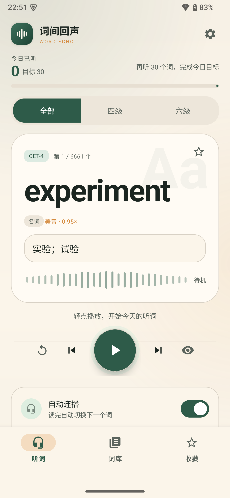
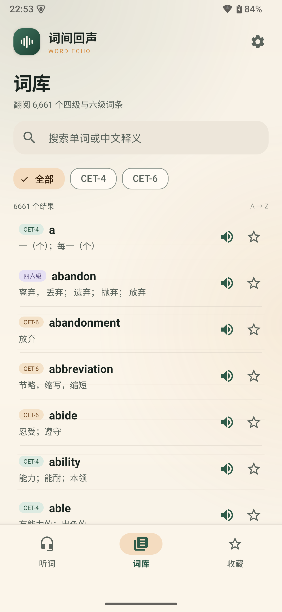
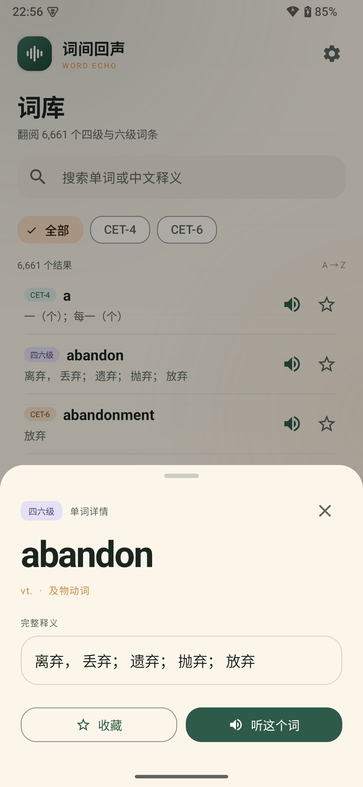
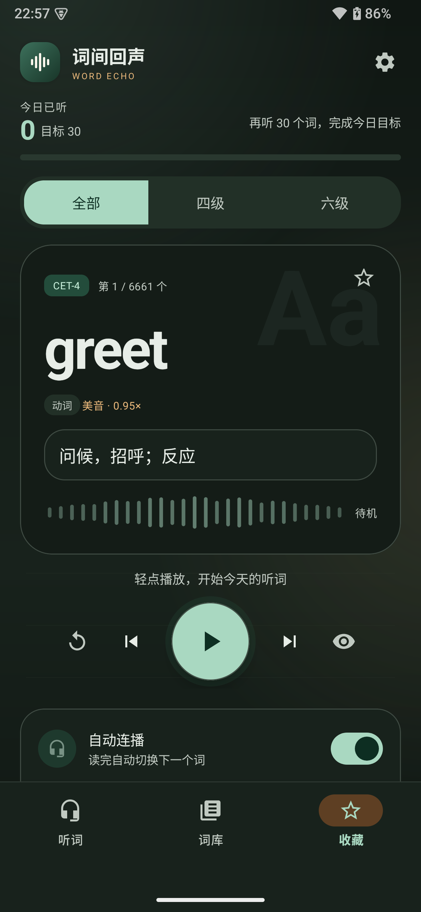

# 词间回声 · Word Echo

一个使用 **Material 3** 设计的离线英语听词 Android 应用。调用系统 TTS，随机朗读大学英语四级 / 六级词汇的英文单词，再朗读中文释义。



## 功能

- **系统 TTS 朗读**：先朗读英文单词，再切换到中文语音朗读释义；支持美音 / 英音、0.60×–1.40× 语速。
- **随机听词**：每轮打乱顺序，全部听完后自动重新洗牌，避免只会听到开头几个词。
- **自动连播**：读完自动切换下一个词，词间间隔可调（1–10 秒）。
- **四 / 六级筛选**：四级、六级、全部三种词库视图；每个词条带有准确级别标记。
- **收藏与复习**：星标收藏保存在本机，可从收藏页随机复习。
- **词库搜索**：按英文拼写或中文释义搜索 6,661 个词条，点击查看完整释义。
- **释义隐藏**：可先遮住中文释义，点按释义区域或眼睛按钮再显示，适合自测。
- **深色模式**：跟随系统、浅色、深色三档，Material 3 动态排版与配色。
- **完全离线**：词库内置在 APK 中，不需要网络权限；仅使用设备已经安装的系统 TTS。

## 截图

| 听词 | 词库 |
| --- | --- |
|  |  |

| 单词详情 | 深色模式 |
| --- | --- |
|  |  |

## 词库

应用启动时读取 `app/src/main/assets/words.tsv`，格式为：

```text
级别掩码<TAB>单词<TAB>中文释义
```

级别掩码：`1` = CET-4，`2` = CET-6，`3` = 两者共有。

当前内置 **6,661 个去重词条**：

- CET-4：4,543 个
- CET-6：3,991 个
- 两库共有：1,873 个

原始词表来自 [KyleBing/english-vocabulary](https://github.com/KyleBing/english-vocabulary)，按 **BSD 3-Clause License** 使用。词表经过去重、合并与级别标记，完整许可见 [THIRD_PARTY_NOTICES.md](THIRD_PARTY_NOTICES.md)。

## 构建

要求：

- JDK 17
- Android SDK Platform 35、Build-Tools 35.x
- Gradle 8.13（项目自带 Wrapper，也可使用本机 Gradle）

```bash
export ANDROID_HOME=/path/to/Android/Sdk
# 或编辑 local.properties:
# sdk.dir=/path/to/Android/Sdk

./gradlew :app:assembleDebug
```

APK 输出：`app/build/outputs/apk/debug/app-debug.apk`。

已发布版本可从 [GitHub Releases](https://github.com/Xinjigalaxy/word-echo/releases/latest) 下载：

```bash
adb install -r WordEcho-v1.0.0.apk
```

> 仓库不包含任何签名密钥。Android Studio / Gradle 会为本地 debug 构建自动生成调试签名；正式发布请使用自己的发布密钥。

## 使用说明

1. 首次打开应用，等待状态栏下方出现「系统语音已就绪」。
2. 选择「四级」「六级」或「全部」，点中央播放按钮开始。
3. 打开「自动连播」后，应用会在词间间隔后自动切换单词。
4. 点词卡右上角星标收藏；在「收藏」页可以随机复习。
5. 如果听不到声音，请点击「系统语音设置」，确认系统 TTS 引擎和中文语音包已安装。

## 项目结构

```text
app/src/main/
├── assets/words.tsv                 # 内置四六级词库
├── java/com/zs/wordecho/
│   ├── MainActivity.java             # 播放调度、导航、收藏、设置协调
│   ├── data/                         # 词条、词库、偏好、收藏
│   ├── speech/SpeechController.java # 系统 TTS 封装（英文 → 中文）
│   └── ui/                           # Material 3 页面、底部弹层、波形
└── res/                              # Material 3 主题、布局、图标
```

## 已知限制

- 没有音标和例句：上游词表只提供单词与释义，应用不伪造发音数据。
- 发音质量取决于系统 TTS 引擎与已安装语音包；不同设备音色可能不同。
- 自动连播在应用退到后台时会暂停，保证不会在用户不知情时持续出声。

## 许可

应用代码可自由用于学习与二次开发。第三方词表使用 BSD 3-Clause License，详见 [THIRD_PARTY_NOTICES.md](THIRD_PARTY_NOTICES.md)。

## 仓库

- GitHub: https://github.com/Xinjigalaxy/word-echo
- 词库与代码均已做脱敏整理，不包含本机 SDK 路径、签名密钥或个人信息。
